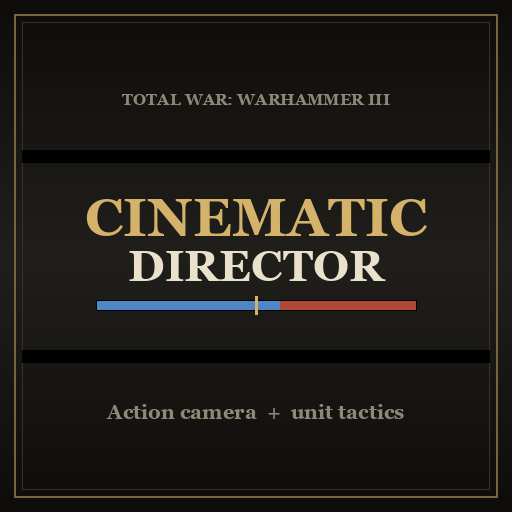

# Cinematic Director

A mod for **Total War: WARHAMMER III**: watch your battles like a film, and let your regiments fight them by the plans you gave them in the campaign.



## Features

- **Unit tactics (Unicorn Overlord style)**: in the campaign, select an army and click **Battle Tactics** to give each regiment a short list of *when → do → target* rows. These include multi-step plays (hammer and anvil, cycle charge, skirmish, focus fire and more), spells for lords and heroes, presets, and up to four switchable tactic sets (paradigms) unlocked by the general's rank. Tactics can still be changed during deployment. Once the battle starts, units follow their tactics on their own and player orders are locked.
- **Cinematic camera**: when deployment ends, the director takes the camera and cuts between charges, clashes, volleys, spells, monsters and heroes. It includes a close charge cam beside charging cavalry, a brace cam behind your line when it's charged, close-ups of heavy spell and artillery hits, and short slow motion at impacts. The *Toggle camera tracking* / *Unit camera* keys take the camera back.
- **Cinematic HUD**: letterbox bars, with callouts over the units naming what's happening (green when it's good for you, red when it's bad). The unit cards stay on screen, and hovering over or clicking a card shows that unit's tactics.

**Multiplayer is untested.** Unit tactics and slow motion switch themselves off in multiplayer battles. The campaign tactics editor has no multiplayer safeguard yet. See [docs/workshop_description.txt](docs/workshop_description.txt) for the full player-facing description.

## Install

Subscribe on the Steam Workshop, or grab `cinematic_director.pack` from the [Releases](../../releases) page (or build it, below) and copy it into
`<Steam>/steamapps/common/Total War WARHAMMER III/data/`, then enable it in the launcher.

## Build

```
python build_pack.py
```

Packs `script/` and `ui/` into `cinematic_director.pack`. The UI templates and skins under `ui/` are generated by `python tools/make_ui.py`; edit the generator, not the XML.

## Layout

| Path | What |
| --- | --- |
| `script/_lib/mod/` | Shared: UI kit (`CD_UI`), tactics catalog (`CD_TACTICS`), ability tables (`CD_ABILITIES`) |
| `script/campaign/mod/` | Campaign tactics editor |
| `script/battle/mod/` | Camera director, HUD, tactics engine, battle tactics panel, banner probe (experiment, off) |
| `ui/` | Generated UI templates and skins |
| `tools/harness/` | Offline [LÖVE](https://love2d.org/) harness that mocks the game API |
| `docs/` | Design notes and Steam Workshop text |
| `retired/`, `builds/` | Older versions kept for reference (not packed) |

## Testing offline

The game is slow to load, so changes are checked in the LÖVE harness first:

```
cd tools/harness
CD_MOD="<path to this repo>/" lovec .                    # campaign editor flow
CD_MOD="<path to this repo>/" CD_SCN=battle lovec .      # battle: tactics, panel, director, HUD
CD_MOD="<path to this repo>/" CD_SCN=plays lovec .       # each play, paradigm switching
CD_MOD="<path to this repo>/" CD_SCN=deploy lovec .      # editing tactics during deployment
CD_MOD="<path to this repo>/" CD_SCN=fights lovec .      # fight states and fight conditions
```

Each run prints `CHECK ... yes/no` lines. `CD_MP=1` runs the battle as multiplayer.

In game, the mod writes `cinematic_director_log.txt` to the game folder (started afresh once it passes 4 MB).

## Credits

Some camera ideas (the finale, lost-target recovery) were inspired by the Cinematic Battle Camera mod. No code from it is used.

## License

[MIT](LICENSE). Unofficial fan mod; not affiliated with Creative Assembly or Games Workshop.
